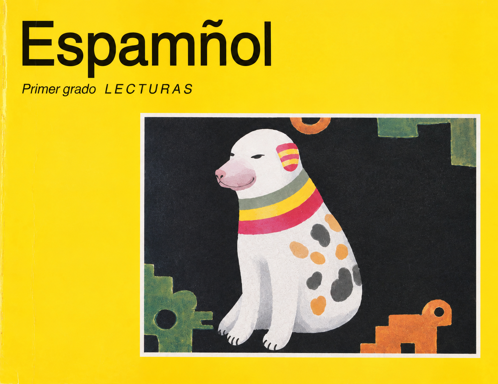

# El perrito 🐶

> Digitalizador y generador de archivos **PDF** y libros electrónicos **EPUB 3** a partir de URLs o claves del catálogo histórico de la **CONALITEG**.
> Bautizado con cariño en honor al legendario *"Libro del perrito"* (*Español. Primer Grado. Lecturas*, Generación 1993, ilustrado con la obra *"El perro dormido"* de Roberto Montenegro).

<p align="center">
  
  <br>
  <em>Edición insignia de prueba: <strong>Español. Primer Grado. Lecturas (Generación 1993 — "El libro del perrito")</strong></em>
</p>

> [!IMPORTANT]
> **Aviso de compatibilidad y alcance**:
> Este proyecto fue probado y calibrado exclusivamente con el libro **Español. Primer Grado. Lecturas (Generación 1993, clave `H1993P1ES139`)**.
> La herramienta permite ingresar URLs de otros libros del acervo histórico de CONALITEG (ej. `https://historico.conaliteg.gob.mx/H1993P1ES139.htm#page/1`), los cuales **podrían funcionar**, pero **no se probarán ni se ofrece soporte para ellos**.

---

## 🎯 ¿Qué hace El perrito?

1. **Generación de documentos PDF de alta calidad**: Convierte las páginas escaneadas oficiales en un PDF consolidado sin pérdida de calidad (*lossless* con `img2pdf`) en menos de 1 segundo.
2. **Generación de EPUB 3 horizontal (Landscape)**: Diseñado en proporción apaisada (`1034×798 px`), con la ilustración oficial en el fondo y el texto del OCR posicionado de forma exacta e interactiva encima de cada palabra (accesible, seleccionable y legible por sintetizadores de voz).
3. **Descarga directa por URL o clave**: Acepta enlaces web de CONALITEG como `https://historico.conaliteg.gob.mx/H1993P1ES139.htm#page/1`, extrayendo automáticamente el identificador y el total de páginas desde `claves.json`.
4. **OCR autónomo de alta precisión**: Motor Baidu PP-OCR (RapidOCR ONNX) con limpieza y normalización ortográfica en español integrada, sin depender de archivos de referencia externos ni del PDF.
5. **Tipografía unificada**: Fuente geométrica escolar embebida (`Quicksand`) con normalización de tamaño (`font-size`) consistente en todo el cuerpo de la página.

---

## 📁 Estructura del Repositorio

```text
perrito/
├── src/perrito/                # Paquete principal Python (El perrito)
│   ├── __init__.py             # Exports y versión
│   ├── cli.py                  # CLI unificado (comando: perrito)
│   ├── config.py               # Catálogo, extracción de URLs y consulta de claves.json
│   ├── download.py             # Descarga concurrente con reintentos y validación Pillow
│   ├── ocr.py                  # Baidu PP-OCR con cajas delimitadoras y limpieza ortográfica
│   ├── epub.py                 # EPUB 3 horizontal con texto superpuesto, TOC y fuente Quicksand
│   └── pdf.py                  # Compilación ultrarrápida de PDFs sin pérdidas (img2pdf)
│
├── tests/                      # Suite de pruebas unitarias (12 pruebas)
│   └── test_basic.py
│
├── main.py                     # Wrapper ejecutable
├── pyproject.toml              # Configuración de paquete (comando: perrito)
├── uv.lock                     # Bloqueo determinista de dependencias
├── LICENSE                     # Licencia MIT y avisos de atribución legal
├── README.md                   # Documentación del proyecto
│
├── H1993P1ES139_paginas/       # [Generado] Imágenes oficiales descargadas (000.jpg a 259.jpg)
├── ocr_texto/                  # [Generado] Archivos JSON con coordenadas relativas y texto limpio
└── dist/                       # [Generado] Archivos finales compilados (.pdf y .epub)
```

---

## 🛠️ Instalación y Requisitos

Este proyecto utiliza [`uv`](https://github.com/astral-sh/uv) para una gestión de dependencias rápida y determinista:

```bash
# 1. Clonar el repositorio
git clone <url-del-repo>
cd conaliteg_pdf_epub

# 2. Sincronizar el entorno virtual
uv sync

# 3. Verificar que el comando esté listo
uv run perrito --help
```

---

## 🚀 Guía de Uso Rápido

### 1. Generar directamente el PDF desde la URL

Descarga automáticamente las páginas (si no se han descargado aún) y compila el archivo PDF:

```bash
# A partir de la URL de CONALITEG:
uv run perrito pdf --url "https://historico.conaliteg.gob.mx/H1993P1ES139.htm#page/1"

# O usando la clave directa:
uv run perrito pdf --book H1993P1ES139
```
El archivo resultante se guardará en `dist/Espanol_Lecturas_1993_1er_Grado.pdf`.

---

### 2. Generar el libro interactivo EPUB 3

Compila el libro en formato apaisado horizontal con la imagen original en el fondo y la capa de texto seleccionable encima:

```bash
# A partir de la URL de CONALITEG:
uv run perrito epub --url "https://historico.conaliteg.gob.mx/H1993P1ES139.htm#page/1"

# O con el comando tradicional build:
uv run perrito build
```
El archivo resultante se guardará en `dist/Espanol_Lecturas_1993_1er_Grado.epub`.

---

### 3. Descarga de páginas únicamente

Si solo deseas descargar las imágenes oficiales escaneadas (por ejemplo, para respaldo o procesamiento externo):

```bash
# Descargar todas las 260 páginas del libro:
uv run perrito download "https://historico.conaliteg.gob.mx/H1993P1ES139.htm#page/1"

# Descargar solo un rango de prueba (ej. páginas 0 a 10):
uv run perrito download --start 0 --end 10

# Descargar y empaquetar automáticamente en archivo .ZIP:
uv run perrito download --zip
```

---

### 4. Ejecución del OCR

Reconoce el texto y genera las cajas delimitadoras exactas (`top`, `left`, `width`, `height`) necesarias para el EPUB:

```bash
# Reconocimiento con Baidu PP-OCR (RapidOCR ONNX):
uv run perrito ocr

# Forzar re-ejecución sobre todas las páginas:
uv run perrito ocr --force
```

---

### 5. Consultar información de un libro o URL

```bash
# Ver información del libro insignia y catálogo base:
uv run perrito info

# Inspeccionar dinámicamente cualquier URL de CONALITEG:
uv run perrito info "https://historico.conaliteg.gob.mx/H1993P1ES139.htm#page/1"
```

---

## 🧪 Pruebas Unitarias y Validación

```bash
# Ejecutar la suite completa de pruebas unitarias:
uv run pytest
```

Todos los libros EPUB generados son validados formalmente con **EPUBCheck 5.1** bajo las reglas de la especificación **EPUB 3.3**, obteniendo **0 errores y 0 advertencias**.

---

## 📜 Aspectos Legales y Atribución

- **Obra original**: *Español. Primer Grado. Lecturas*, Plan y Programas de Estudio 1993.
- **Edición original**: Comisión Nacional de Libros de Texto Gratuitos (CONALITEG) / Secretaría de Educación Pública (SEP), México.
- **Propósito**: Preservación cultural, histórica y archivo educativo personal sin fines de lucro.
- **Derechos de autor**: Las imágenes y textos originales pertenecen a sus respectivos autores y a la CONALITEG / SEP. Esta herramienta únicamente facilita la consulta, descarga y conversión técnica para uso privado y educativo.
